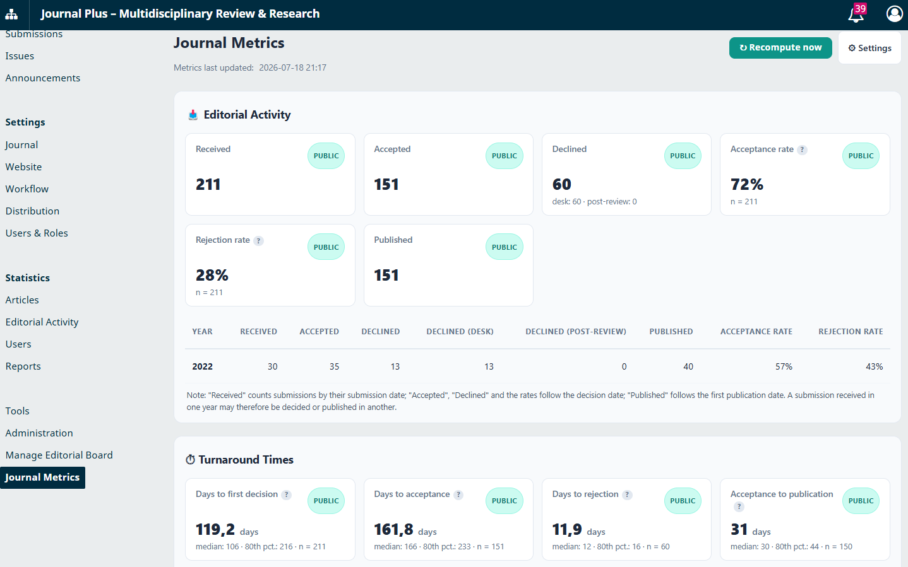
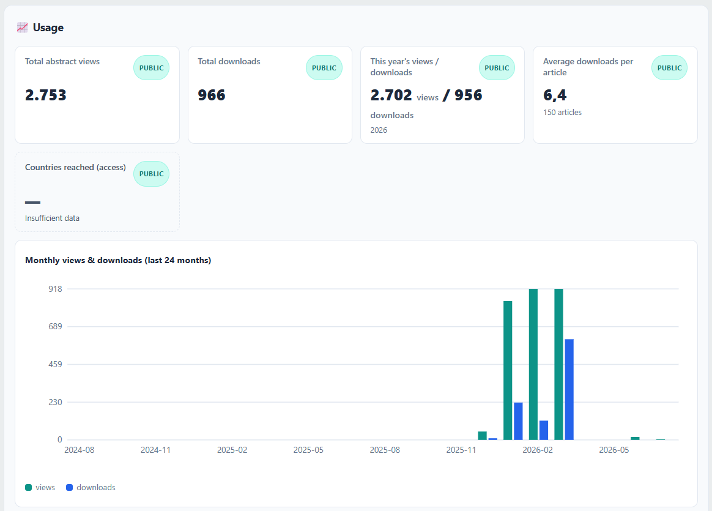
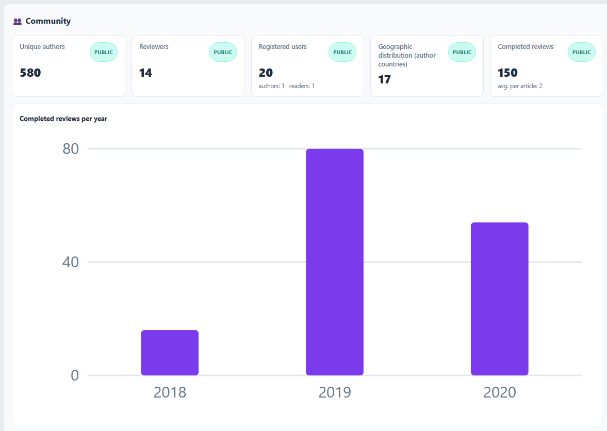
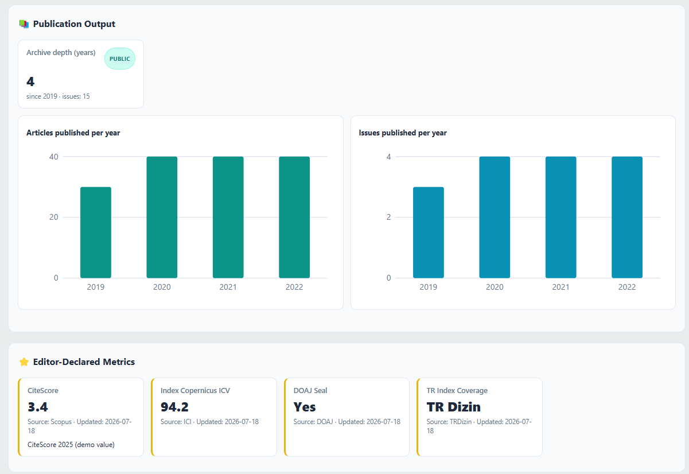
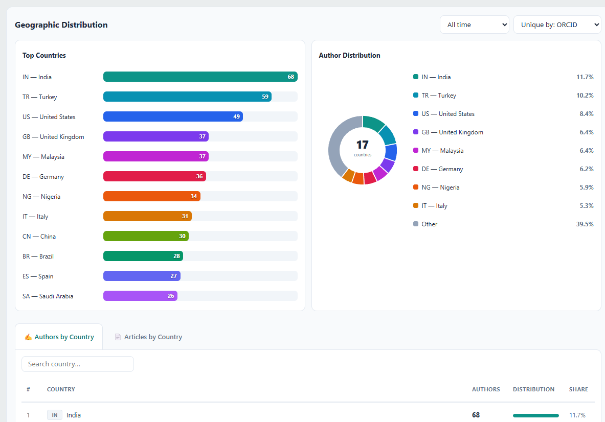
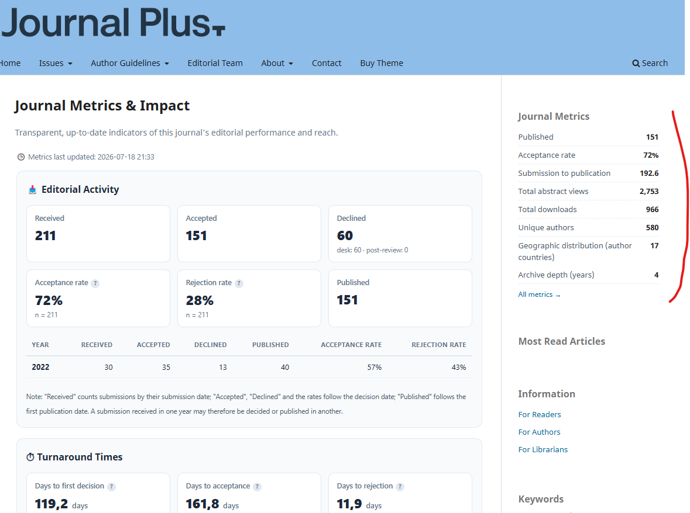
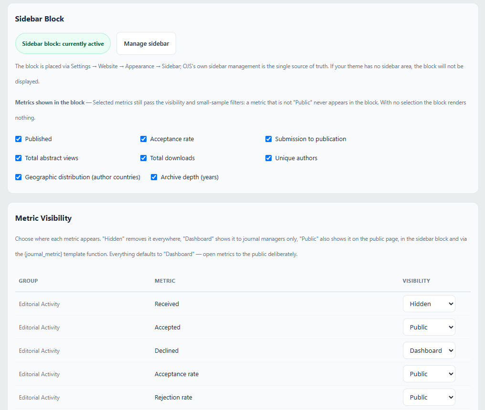

# Journal Metrics for OJS

**English** · [Türkçe](README_TR.md)

**Show the numbers that matter about your journal — automatically, transparently, in one place.**

Journal Metrics is a generic plugin for Open Journal Systems 3.3 that turns the
data already inside your OJS installation into a professional metrics page:
editorial activity, turnaround times, readership, community reach and
publication output. Journals use it to strengthen indexing applications
(DOAJ, Scopus, Web of Science and regional indexes ask for exactly these
numbers), to give authors realistic expectations about review and publication
times, and to demonstrate editorial transparency to readers and institutions.

## What you get

- **Admin dashboard** — every metric at a glance: metric cards, per-year
  tables, a 24-month usage trend, most-read articles and a full geographic
  distribution section (author/article countries with charts and tables).
- **Public metrics page** — a clean, theme-aware page at
  `/journalmetrics/publicpage` showing **only** the metrics you choose to
  publish. Print-friendly: the page breaks cleanly on A4, ready to attach to
  an indexing application.
- **Sidebar block** — selected public metrics in your journal's sidebar.
- **`{journal_metric}` template function** — theme developers can place any
  public metric anywhere: `{journal_metric key="submissionsPublished"}`.
- **Navigation menu integration** — add the public page to any menu with the
  built-in "Journal Metrics" menu item type.
- **Multilingual** — TR/EN interface; the public page title and
  editor-declared metrics accept a value per active journal language.

## Screenshots

**Admin dashboard**







**Public metrics page & sidebar block**



**Settings**



## The metric catalogue

**Editorial activity** — submissions received, accepted, declined (with
desk/post-review split), articles published, acceptance and rejection rates.
Counters come from OJS's own editorial statistics engine, so they always
match the built-in Statistics screens.
*Acceptance rate* = accepted ÷ (accepted + declined): among submissions that
reached a final decision, the share that were accepted. Submissions still
under review are not counted, and the "n" under the rate is its denominator.

**Turnaround times** — days to first decision, to acceptance, to rejection,
average review time, acceptance-to-publication and submission-to-publication.
Every time metric reports the average, the median, the 80th percentile (the
value 80% of articles stay under) and the number of articles measured, so a
single outlier can never distort the story.

**Usage** — total abstract views and file downloads, this year's figures,
average downloads per article, the ten most-read articles and a 24-month
views/downloads trend, all from OJS's standard usage statistics.

**Community** — unique authors (with configurable ORCID → e-mail → name
de-duplication), reviewers, registered users, completed reviews per year and
the geographic distribution of your authors.

**Publication output** — articles per year, issues per year and archive depth.

**Editor-declared metrics** — up to five values that do not live in OJS
(CiteScore, index coverage, and similar). They are entered by the editorial
team with a source and are shown separately from the automatic metrics, each
stamped with its last update date.

## Built on trust

- Automatic values are **computed, never edited**. Editors decide what is
  shown or hidden — they cannot change a number.
- Values the editor enters by hand (external indicators) are marked
  "Entered by the editor" and can never stand in for a computed figure.
- Every public page carries a **"Metrics last updated"** stamp, and every rate
  and time metric explains its methodology in a tooltip.
- Small samples are handled honestly: rates and times based on fewer records
  than a configurable threshold are suppressed instead of shown as misleading
  precision.
- Scope is never narrowed silently: if a journal declares a coverage start
  year for its editorial statistics, that coverage is always announced right
  on the page, next to the numbers it applies to.

## Works with every kind of journal

- **Journals managing the full workflow in OJS** get the complete catalogue
  automatically — editorial counters, rates and all turnaround times included.
- **Journals that add articles directly** (back issues, XML import, articles
  added to an issue without a decision) see every published article in the
  publication figures; the editorial section appears once enough submissions
  have an editor decision. No setting is needed for this.
- Every metric has its own visibility switch: **Hidden**, **Dashboard**
  (managers only, the default) or **Public**. Nothing is published unless an
  editor deliberately opens it.

## Installation

1. Website Settings → Plugins → **Upload A New Plugin** and select
   `journalMetrics-ojs3.3-1.0.3.9.tar.gz`.
2. Enable **Journal Metrics** under Generic Plugins.
3. Open **Journal Metrics** from the left management menu; the fast metric
   groups are computed on first visit.
4. **Run the scheduled task once after installation** so usage statistics are
   computed immediately (they are otherwise picked up by the next scheduled
   run):

   ```
   php tools/runScheduledTasks.php plugins/generic/journalMetrics/scheduledTasks.xml
   ```

The plugin registers itself with the Acron plugin and refreshes its snapshot
automatically (hourly runs, one full recomputation per day). On large
installations we recommend adding the command above as a real cron job.
No `config.inc.php` changes and no FTP access are required.

## Configuration

Everything lives on one settings page (Journal Metrics → **Settings**):
the public page switch and title, the "Editorial process" section
(automatic / always / hide), the per-metric visibility matrix, external
indicators, author de-duplication strategy, display options, the
small-sample threshold and a "Recompute now" button. The
"Developed by ojs-services.com" credit link on the public page can also be
turned off there.

**Advanced** (closed by default; not needed for correct figures):
- **Start year** — many journals moved to OJS mid-life, so submission dates
  and editor decisions only exist for recent years. With a start year, the
  editorial figures (counters, rates, times, completed reviews) cover that
  year onward and the pages say so next to the last-updated stamp. The
  system never guesses this year.
- **Sections left out of the publication counts** — for example Editorial
  or Erratum.
- **Articles-per-year split** — a small table under the chart: articles
  through the editorial process / added directly.

## How the metrics are calculated

Every figure follows the same few rules.

1. **Publication figures** — published articles, articles and issues per
   year, authors, countries, views and downloads — count every published
   article, wherever it came from: submitted through OJS, added straight to
   an issue, or imported. The "Published articles" card always equals the
   total of the articles-per-year chart.
2. **Editorial figures** — received, accepted and declined submissions,
   acceptance and rejection rates — count only submissions that went
   through the editorial process: a completed submission with at least one
   editor decision (recommendations do not count). A rate is accepted (or
   declined) divided by all decided submissions; rejections before and
   after review are shown separately.
3. **Times** — first decision, acceptance, rejection, acceptance to
   publication, submission to publication, review time — use the same
   submissions, and only when their dates fit together. A submission dated
   after its own publication (typical for imported archives) counts in the
   figures above, not in times.
4. An article added to an issue without any editor decision counts as a
   publication only — never as a received submission, in a rate or in a
   time. This is decided per article, whenever it was added; the system
   never guesses a date.
5. Every rate and time card shows **n**, the number of submissions behind
   it. A figure resting on too few submissions is not shown publicly
   rather than shown as a misleading 0 %.

On the public page the figures appear under two headings, **Publications**
and **Editorial process**. When articles were added without a decision, one
sentence with the numbers says so under Editorial process. The editorial
section appears automatically once 20 submissions have a final editor
decision (or always / never — one setting). The sidebar block and
`{journal_metric}` follow the same choice: while the section is hidden, its
figures do not appear there either. On the dashboard and the
settings page, managers see a short box with numbers that says which
articles count where, with a list of those articles.

**External indicators** — up to five values OJS cannot calculate, such as
indexing coverage or an external impact score, each marked "Entered by the
editor". A value named like a computed figure (for example "Acceptance
rate") cannot be saved: rates, times and article counts always come from
the journal's own data.


## Compatibility

| | |
|---|---|
| OJS | 3.3.0.x (every OJS 3.3.0 release) |
| PHP | 7.4 – 8.1 |
| Database | MySQL / MariaDB (standard OJS setups) |
| Journals | single- and multi-journal installations |
| Themes | works on any OJS 3.3 theme — default or custom; see our themes: [ojs-services.com/ojs-themes](https://ojs-services.com/ojs-themes) |
| Plugin version | 1.0.3.9 |

## License & support

GNU GPL v3.

**OJS Services** — [ojs-services.com](https://ojs-services.com) · info@ojs-services.com
