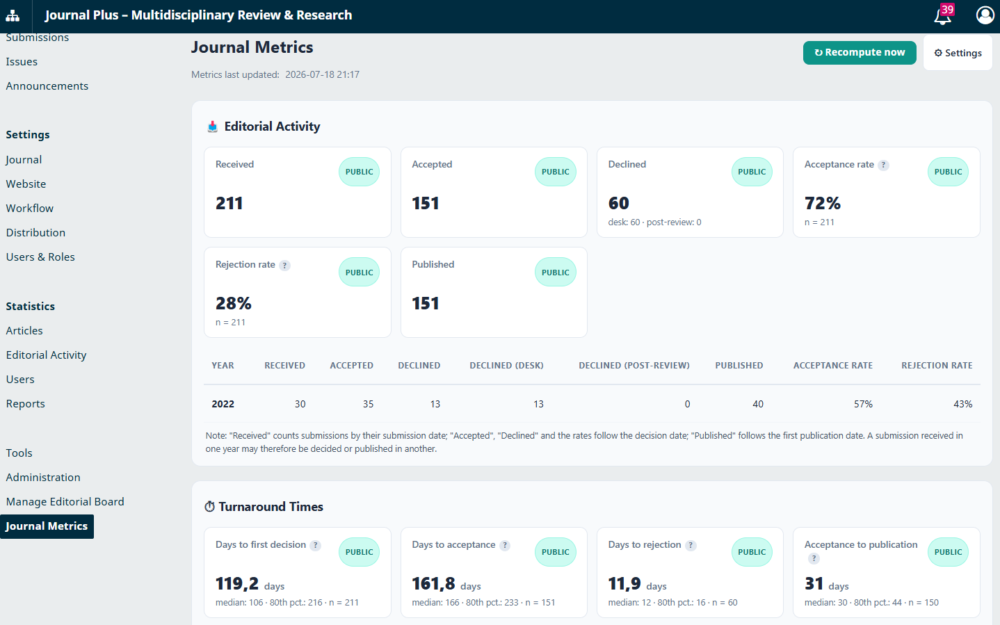
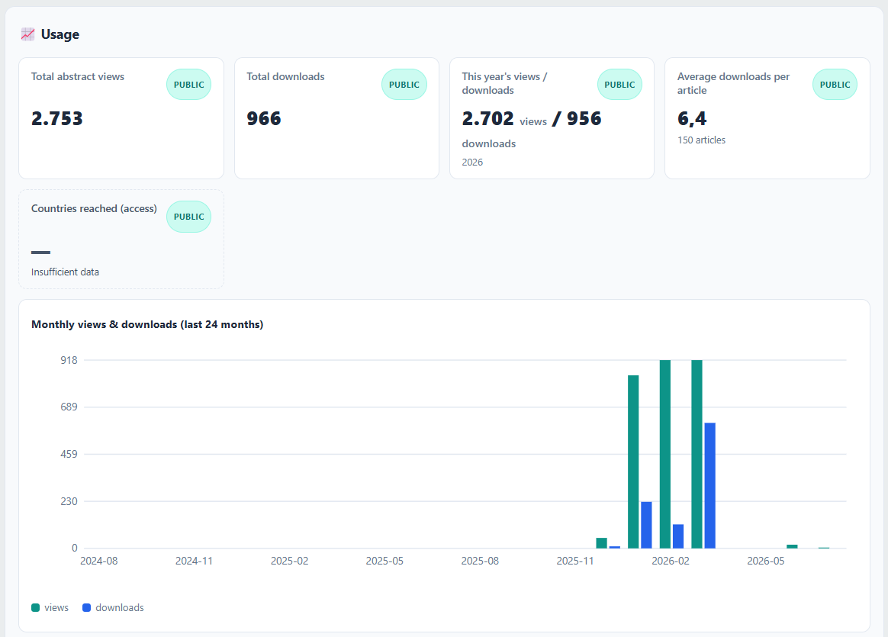
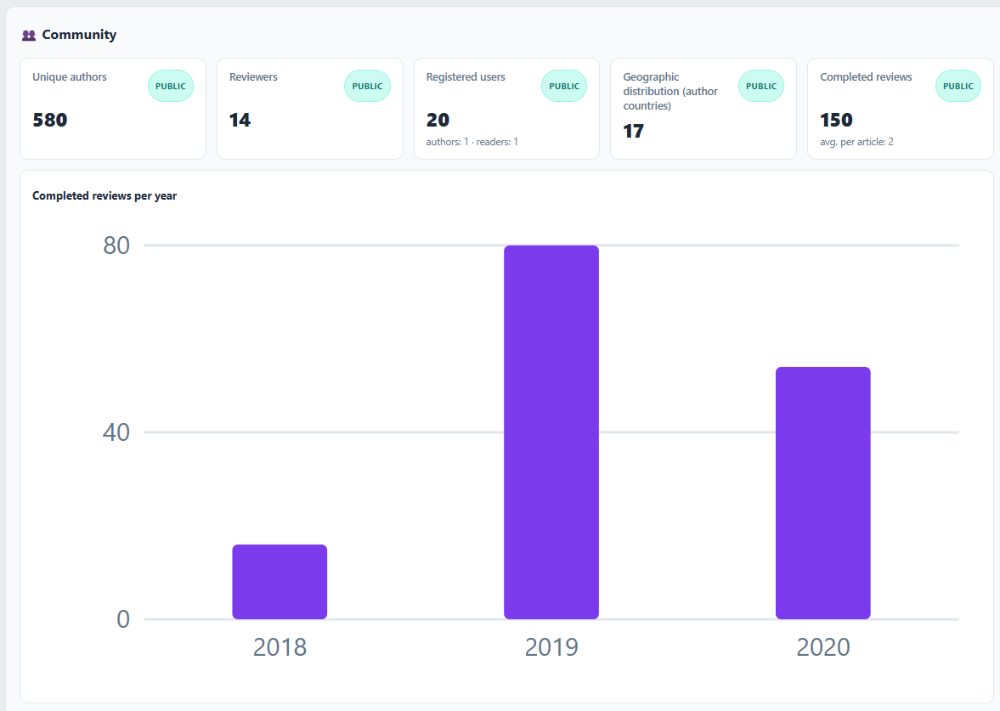
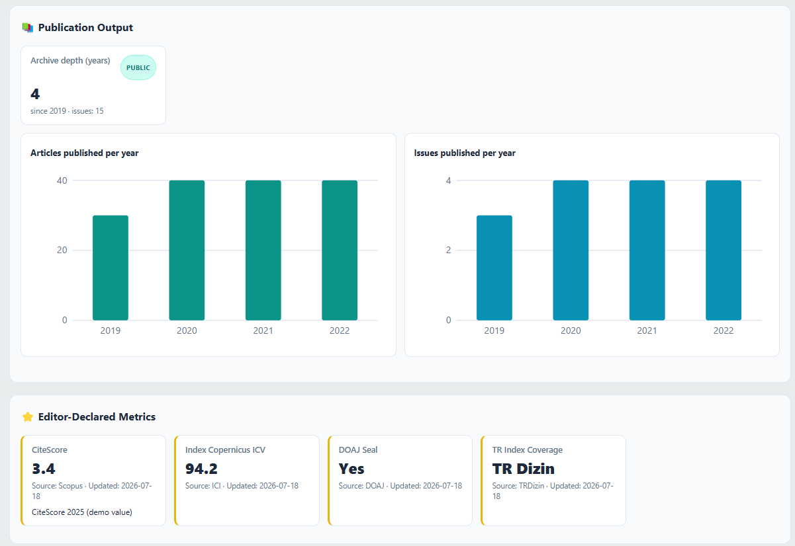
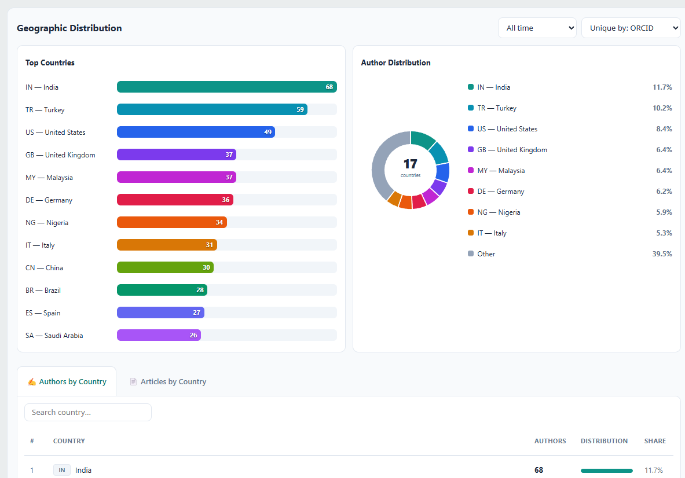
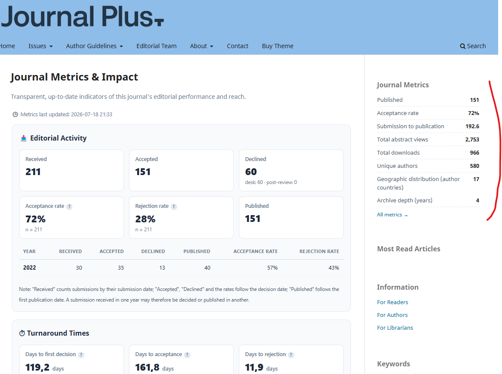
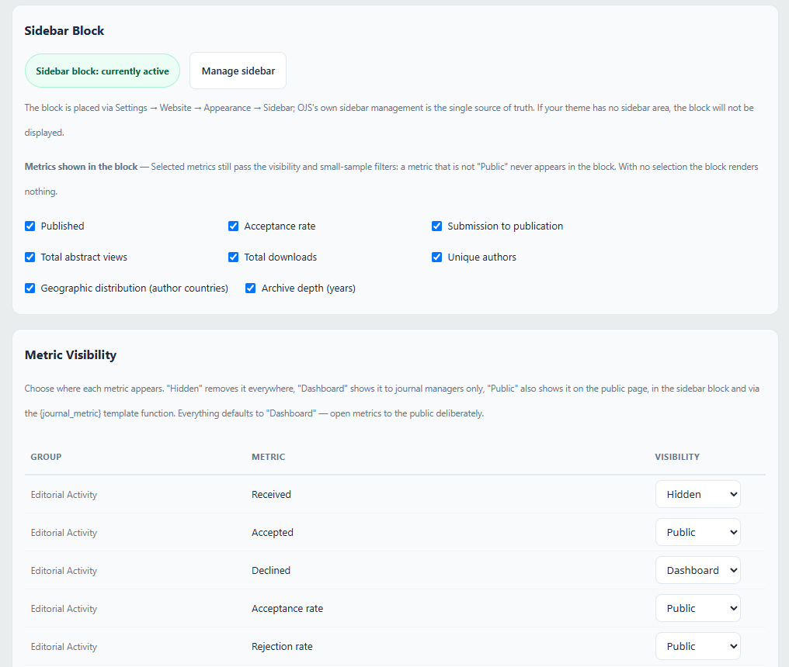

# Journal Metrics for OJS

[English](README.md) · **Türkçe**

**Derginiz hakkındaki önemli sayıları — otomatik, şeffaf ve tek sayfada gösterin.**

Journal Metrics, OJS 3.3 kurulumunuzun içinde zaten var olan verileri
profesyonel bir metrik sayfasına dönüştüren bir generic eklentidir: editoryal
etkinlik, süreç süreleri, okunma, topluluk erişimi ve yayın çıktısı. Dergiler
bu sayfayı dizin başvurularını güçlendirmek (DOAJ, Scopus, Web of Science ve
bölgesel dizinler tam olarak bu sayıları ister), yazarlara hakemlik ve yayın
süreleri hakkında gerçekçi beklenti vermek ve okuyucular ile kurumlara
editoryal şeffaflık göstermek için kullanır.

## Neler sunar

- **Yönetici panosu** — tüm metrikler tek bakışta: metrik kartları, yıllık
  tablolar, 24 aylık kullanım eğilimi, en çok okunan makaleler ve grafikli/
  tablolu tam coğrafi dağılım bölümü (yazar/makale ülkeleri).
- **Kamuya açık metrik sayfası** — `/journalmetrics/publicpage` adresinde,
  yalnızca **sizin yayınlamayı seçtiğiniz** metrikleri gösteren, temayla
  uyumlu temiz bir sayfa. Yazdırma dostudur: A4'te düzgün bölünür, dizin
  başvurusuna ek olarak vermeye hazırdır.
- **Kenar çubuğu bloğu** — seçili kamuya açık metrikler derginizin kenar
  çubuğunda.
- **`{journal_metric}` şablon fonksiyonu** — tema geliştiricileri herhangi bir
  kamuya açık metriği istedikleri yere koyabilir:
  `{journal_metric key="submissionsPublished"}`.
- **Gezinme menüsü entegrasyonu** — yerleşik "Dergi Metrikleri" menü öğesi
  türüyle kamu sayfasını istediğiniz menüye ekleyin.
- **Çok dilli** — TR/EN arayüz; kamu sayfası başlığı ve editör beyanı
  metrikler derginin her aktif dili için ayrı değer kabul eder.

## Ekran görüntüleri

**Yönetici panosu**







**Kamuya açık metrik sayfası ve kenar çubuğu bloğu**



**Ayarlar**



## Metrik kataloğu

**Editoryal etkinlik** — alınan, kabul edilen, reddedilen gönderiler
(masa/hakem sonrası kırılımıyla), yayınlanan makaleler, kabul ve ret oranları.
Sayaçlar OJS'nin kendi editoryal istatistik motorundan gelir; bu yüzden
yerleşik İstatistik ekranlarıyla her zaman aynıdır.
*Kabul oranı* = kabul ÷ (kabul + ret): nihai karar almış gönderiler içinde
kabul edilenlerin payı. İncelemesi süren gönderiler sayılmaz; oranın altındaki
"n" paydasıdır.

**Süreç süreleri** — ilk karara, kabule, redde kadar geçen gün; ortalama
hakemlik süresi; kabulden yayına ve gönderiden yayına geçen süre. Her süre
metriği ortalama, medyan, %80 dilimi (makalelerin %80'inin altında kaldığı
değer) ve ölçülen makale sayısıyla birlikte raporlanır — tek bir uç değer
tabloyu asla çarpıtamaz.

**Kullanım** — toplam özet görüntüleme ve dosya indirme, bu yılın rakamları,
makale başına ortalama indirme, en çok okunan on makale ve 24 aylık
görüntüleme/indirme eğilimi; tamamı OJS'nin standart kullanım
istatistiklerinden.

**Topluluk** — benzersiz yazarlar (yapılandırılabilir ORCID → e-posta → ad
soyad benzersizleştirmesiyle), hakemler, kayıtlı kullanıcılar, yıllara göre
tamamlanan hakemlikler ve yazarlarınızın coğrafi dağılımı.

**Yayın çıktısı** — yıllık makale sayısı, yıllık sayı adedi ve arşiv derinliği.

**Editör beyanı metrikler** — OJS'de bulunmayan en fazla beş değer (CiteScore,
dizin kapsamı vb.). Editör ekibi tarafından kaynağıyla girilir, otomatik
metriklerden ayrı gösterilir ve her biri son güncelleme tarihiyle damgalanır.

## Güven üzerine kurulu

- Otomatik değerler **hesaplanır, asla elle değiştirilemez**. Editörler neyin
  gösterilip gizleneceğine karar verir — sayıyı değiştiremez.
- Editörün elle girdiği değerler (dış göstergeler) "Editör tarafından
  girildi" işaretini taşır ve hiçbir zaman hesaplanan bir göstergenin yerini
  tutamaz.
- Her kamu sayfasında **"Metriklerin son güncellenmesi"** damgası bulunur;
  her oran ve süre metriği metodolojisini ipucu balonuyla açıklar.
- Küçük örneklemler dürüstçe ele alınır: ayarlanabilir eşiğin altında kayda
  dayanan oran ve süreler, yanıltıcı bir kesinlikle gösterilmek yerine
  bastırılır.
- Kapsam asla sessizce daraltılmaz: dergi, editoryal istatistikleri için bir
  kapsam başlangıç yılı beyan ettiğinde bu kapsam her zaman sayfada, ait
  olduğu sayıların hemen yanında açıkça duyurulur.

## Her tür dergiyle çalışır

- **İş akışını tamamen OJS'de yürüten dergiler** kataloğun tamamını otomatik
  alır — editoryal sayaçlar, oranlar ve tüm süreç süreleri dahil.
- **Makaleleri doğrudan ekleyen dergiler** (geçmiş sayılar, XML aktarımı,
  karar olmadan sayıya eklenen makaleler) yayımlanmış her makaleyi yayın
  sayılarında görür; editoryal bölüm, yeterli sayıda gönderi editör kararı
  alınca kendiliğinden görünür. Bunun için ayar gerekmez.
- Her metriğin kendi görünürlük anahtarı vardır: **Gizli**, **Pano** (yalnız
  yöneticiler; varsayılan) veya **Kamuya açık**. Editör bilinçli olarak
  açmadıkça hiçbir şey yayınlanmaz.

## Kurulum

1. Web Sitesi Ayarları → Eklentiler → **Yeni Eklenti Yükle** ile
   `journalMetrics-ojs3.3-1.0.3.9.tar.gz` dosyasını seçin.
2. Generic Eklentiler altında **Journal Metrics**'i etkinleştirin.
3. Sol yönetim menüsünden **Dergi Metrikleri**'ni açın; hızlı metrik grupları
   ilk ziyarette hesaplanır.
4. **Kurulumdan sonra zamanlanmış görevi bir kez çalıştırın** ki kullanım
   istatistikleri hemen hesaplansın (aksi halde bir sonraki zamanlanmış
   koşuda hesaplanır):

   ```
   php tools/runScheduledTasks.php plugins/generic/journalMetrics/scheduledTasks.xml
   ```

Eklenti kendini Acron eklentisine kaydeder ve snapshot'ını otomatik yeniler
(saatlik koşular, günde bir tam yeniden hesaplama). Büyük kurulumlarda
yukarıdaki komutun gerçek bir cron görevi olarak eklenmesini öneririz.
`config.inc.php` düzenlemesi ve FTP erişimi gerekmez.

## Yapılandırma

Her şey tek ayar sayfasındadır (Dergi Metrikleri → **Ayarlar**): kamu sayfası
anahtarı ve başlığı, "Editoryal süreç" bölümü (otomatik / her zaman / gizle),
metrik bazlı görünürlük matrisi, dış göstergeler, yazar benzersizleştirme
stratejisi, görünüm seçenekleri, küçük örneklem eşiği ve "Şimdi yeniden
hesapla" düğmesi. Kamu sayfasındaki "ojs-services.com tarafından
geliştirilmiştir" bağlantısı da buradan kapatılabilir.

**Gelişmiş** (varsayılan olarak kapalı; doğru sayılar için gerekmez):
- **Başlangıç yılı** — birçok dergi OJS'ye yayın hayatının ortasında geçer;
  gönderi tarihleri ve editör kararları yalnız son yıllarda vardır. Başlangıç
  yılı girilirse editoryal göstergeler (sayaçlar, oranlar, süreler,
  tamamlanan hakemlikler) o yıldan itibaren hesaplanır ve sayfa bunu son
  güncelleme damgasının yanında söyler. Sistem bu yılı tahmin etmez.
- **Yayın sayılarına katılmayacak bölümler** — ör. Editöryal ya da Erratum.
- **Yıllara göre makale kırılımı** — grafiğin altında küçük bir tablo:
  editoryal süreçten geçen / doğrudan eklenen makaleler.

## Metrikler nasıl hesaplanır

Bütün göstergeler aynı birkaç kurala uyar.

1. **Yayın göstergeleri** — yayımlanan makale, yıllara göre makale ve sayı,
   yazarlar, ülkeler, görüntüleme ve indirme — yayımlanmış her makaleyi
   sayar; makalenin nereden geldiğine bakılmaz: OJS üzerinden gönderilmiş,
   doğrudan sayıya eklenmiş ya da içe aktarılmış olabilir. "Yayımlanan
   makale" kartı her zaman yıllara göre makale grafiğinin toplamına eşittir.
2. **Editoryal göstergeler** — alınan, kabul edilen ve reddedilen gönderi,
   kabul ve ret oranı — yalnız editoryal süreçten geçen gönderileri sayar:
   tamamlanmış ve en az bir editör kararı almış gönderi (öneriler karar
   sayılmaz). Oran, kabul (ya da ret) sayısının karar verilmiş bütün
   gönderilere bölümüdür; değerlendirme öncesi ve hakem sonrası ret ayrı
   gösterilir.
3. **Süreler** — ilk karar, kabul, ret, kabulden yayına, gönderimden yayına,
   hakem süresi — aynı gönderileri, yalnız tarihleri birbiriyle tutarlıysa
   kullanır. Kendi yayınından sonra gönderilmiş görünen bir makale (içe
   aktarılan arşivlerde sık görülür) yukarıdaki sayılara girer, sürelere
   girmez.
4. Editör kararı olmadan doğrudan sayıya eklenen makale yalnız yayın olarak
   sayılır — alınan gönderi, oran ya da süre olarak asla. Bu, ne zaman
   eklendiğine bakılmaksızın her makale için ayrı ayrı belirlenir; sistem
   tarih tahmin etmez.
5. Her oran ve süre kartı, dayandığı gönderi sayısını (**n**) gösterir. Çok
   az gönderiye dayanan bir gösterge, yanıltıcı bir %0 olarak gösterilmek
   yerine kamu sayfasında gösterilmez.

Kamu sayfasında göstergeler iki başlık altında yer alır: **Yayınlar** ve
**Editoryal süreç**. Karar olmadan eklenen makaleler varsa Editoryal süreç
başlığının altında bunu sayılarla söyleyen tek bir cümle çıkar. Editoryal
bölüm, 20 gönderi son editör kararını alınca kendiliğinden görünür (ya da
her zaman / hiçbir zaman — tek ayar). Kenar çubuğu bloğu ve
`{journal_metric}` aynı seçime uyar: bölüm gizliyken o bölümün sayıları
orada da görünmez. Yöneticiler panoda ve ayar sayfasında
hangi makalenin nerede sayıldığını sayılarla anlatan kısa bir kutu ve bu
makalelerin listesini görür.

**Dış göstergeler** — OJS'in hesaplayamadığı en fazla beş değer (dizin
kapsamı, dış etki puanı gibi); her birinde "Editör tarafından girildi"
yazar. Hesaplanan bir göstergenin adını taşıyan değer (ör. "Kabul oranı")
kaydedilemez: oranlar, süreler ve makale sayıları her zaman derginin kendi
verisinden gelir.


## Uyumluluk

| | |
|---|---|
| OJS | 3.3.0.x (bütün OJS 3.3.0 sürümleri) |
| PHP | 7.4 – 8.1 |
| Veritabanı | MySQL / MariaDB (standart OJS kurulumları) |
| Dergiler | tek ve çok dergili kurulumlar |
| Temalar | her OJS 3.3 temasıyla çalışır — varsayılan veya özel; temalarımız: [ojs-services.com/ojs-themes](https://ojs-services.com/ojs-themes) |
| Eklenti sürümü | 1.0.3.9 |

## Lisans ve destek

GNU GPL v3.

**OJS Services** — [ojs-services.com](https://ojs-services.com) · info@ojs-services.com
